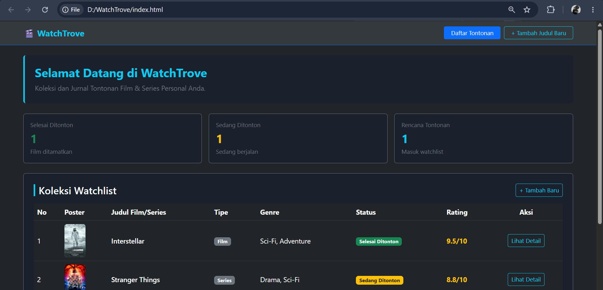
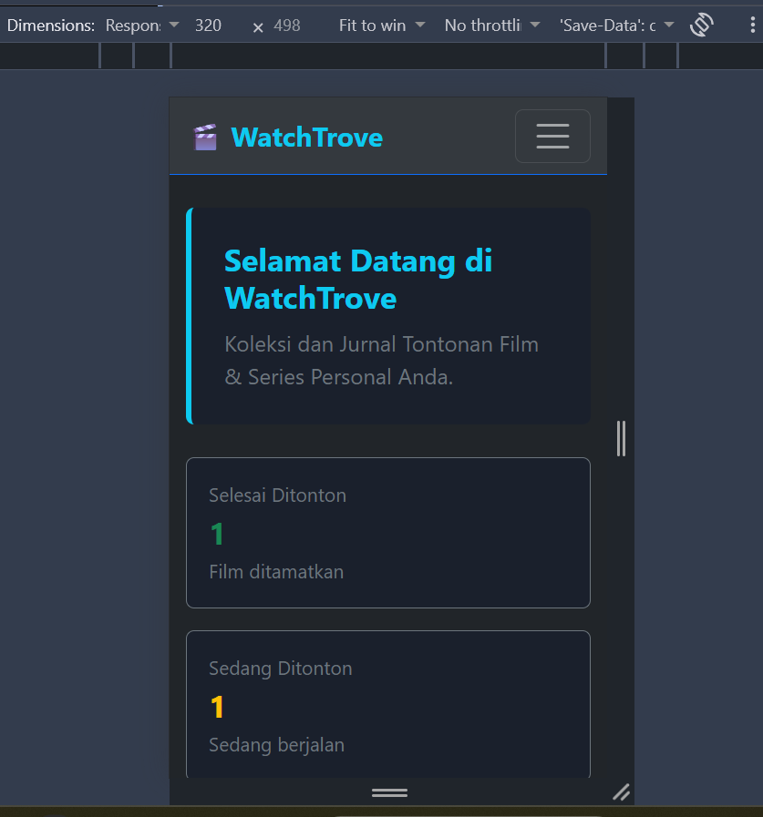
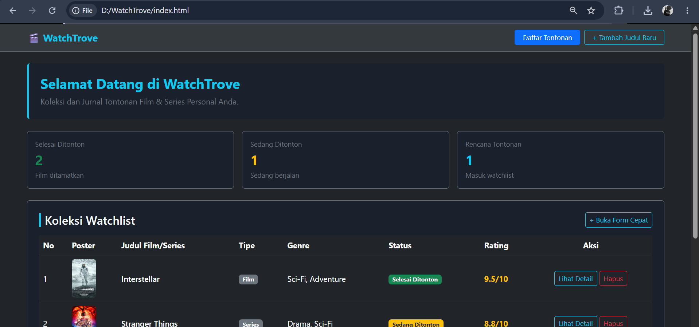
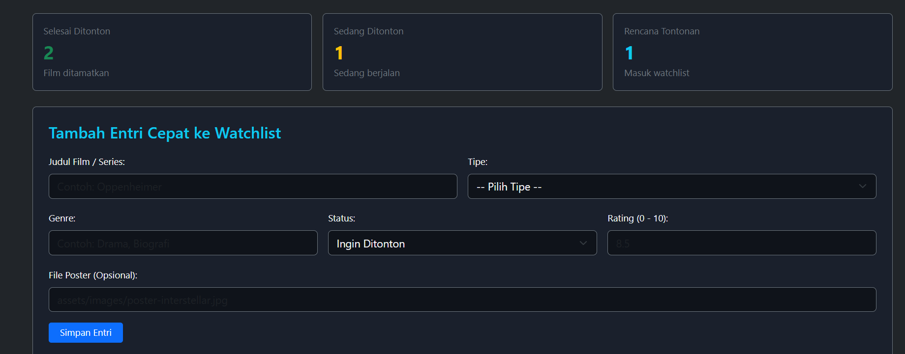
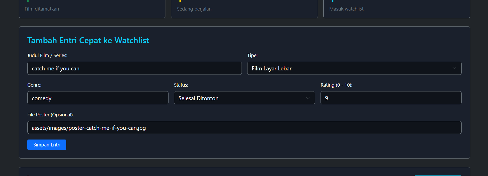
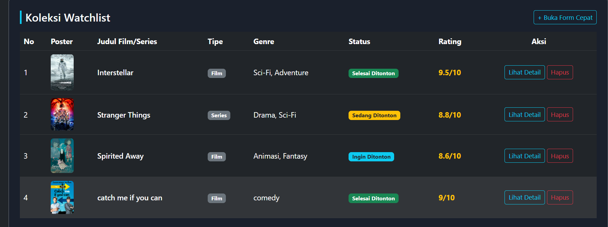
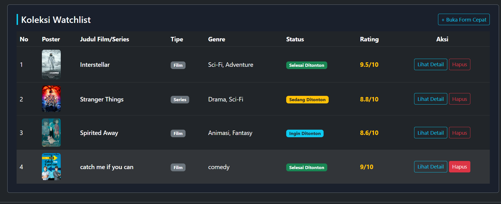
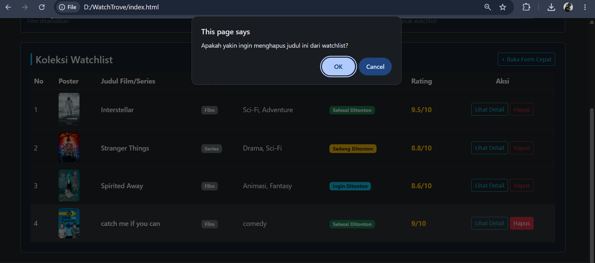

# WatchTrove - Frontend Skeleton (Bootstrap)

## Deskripsi Proyek
WatchTrove adalah aplikasi jurnal dan koleksi tontonan film & series personal. Tahap ini merupakan pembangunan kerangka antarmuka responsif menggunakan framework CSS Bootstrap 5.

## Alasan Pemilihan Framework (Bootstrap)
Bootstrap dipilih karena pendekatannya yang component-based mempercepat pembuatan antarmuka yang konsisten dan rapih. Bootstrap menyediakan sistem grid 12 kolom yang stabil untuk dashboard dan form, serta memiliki styling tabel dan formulir bawaan yang mempermudah pembuatan kerangka katalog media secara terstruktur. saya juga lebih familiar dengan bootstrap jadinya menggunakan bootstrap

## Tampilan Antarmuka

### Tampilan Desktop

### Tampilan Mobile

## progress Week 5

berikut adalah progress tugas saya di week 5

### 1. Efek SlideToggle (Buka/Tutup Form Cepat)
| Sebelum Interaksi (Form Tertutup) | Sesudah Interaksi (Form Terbuka) |
| :---: | :---: |
|  |  |

### 2. Penambahan Data & Validasi Form
| Sebelum Submit (Input Terisi) | Sesudah Submit (Data Masuk & Notifikasi Tampil) |
| :---: | :---: |
|  |  |

### 3. Penghapusan Entri Tontonan (DOM Remove & fadeOut)
| Sebelum Dihapus (Item Masih Ada) | Sesudah Dihapus (Item Hilang & Statistik Berkurang) |
| :---: | :---: |
|  |  |

## Video Demonstrasi Interaktivitas
Video singkat demo fungsionalitas interaktif (slideToggle, penambahan entri, validasi form, dan penghapusan data)

